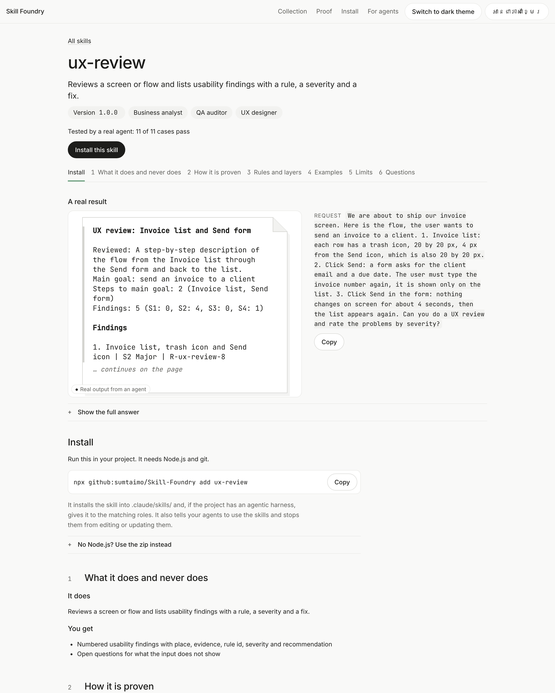
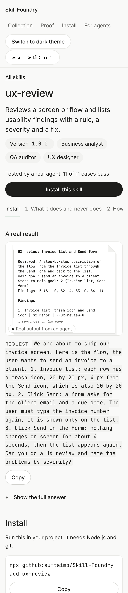

# Skill page length, 2026-11-16 (site work, not a skill)

TAIMO's decision (chat): show the request once, beside the real result; collapse the full word-for-word answer by default.

## What changed (src/site and tests only)

- The request text was shown 3 to 4 times on a page (inside the cover, beside it, in "How to ask", in the answer block). It is now shown once, beside the real result, with a Copy button (`src/site/lib/render.mjs`). The cover on a skill page is the same figure without the request block (`docFigure` option `showAsk`, `src/site/lib/proof.mjs`); the landing page and the banner keep the cover unchanged.
- The full answer is a closed accordion "Show the full answer" under the result (`
`). The text is in the HTML, so it reads without JavaScript. A link to `#answer` opens it (`src/site/assets/site.js`).
- The "How to ask" section is gone (its content was the same request). Seven numbered sections became six.
- The duplicate answer block in Examples is gone. design-system's swatch figure and the interactive recorded run (figure-craft, skill-smith) are now closed accordions in Examples.
- A skill whose cover is a recorded run with a different request than its answer recording (figure-craft) shows the recording's own request inside the answer accordion, so an answer never appears without its request.
- The recorded real result is still the biggest thing on the page. Every number and quote still comes from the recording: `tests/site-real-output.test.mjs` still proves the answer text equals the recording and now also proves the request appears exactly once, sits beside the result, the cover does not repeat it, and the answer accordion is closed and in the HTML.
- New string `answer.show` in English and Khmer. The Khmer line is a draft and needs a native review (STATUS section 5, question 2).

## Page height in px (all accordions closed, viewport 900 high)

| Skill page | 1440 before | 1440 after | change | 390 before | 390 after | change |
|---|---|---|---|---|---|---|
| a11y-audit | 3924 | 2955 | -969 | 5173 | 3753 | -1420 |
| changelog-writer | 3609 | 2903 | -706 | 4520 | 3606 | -914 |
| copy-tight | 3518 | 2908 | -610 | 4477 | 3583 | -894 |
| design-system | 4640 | 3083 | -1557 | 5427 | 3736 | -1691 |
| figure-craft | 4472 | 3254 | -1218 | 5542 | 4065 | -1477 |
| skill-smith | 4130 | 3244 | -886 | 5339 | 4015 | -1324 |
| spec-writer | 4060 | 3091 | -969 | 5361 | 3940 | -1421 |
| test-planner | 3740 | 2982 | -758 | 4603 | 3638 | -965 |
| ui-polish | 3745 | 2980 | -765 | 4457 | 3522 | -935 |
| ux-review | 4026 | 2955 | -1071 | 5481 | 3881 | -1600 |

Target was about 3 screens at 1440 (about 2700 px). Seven pages are at 2900 to 3100 px (3.2 to 3.4 screens); figure-craft and skill-smith are at 3250 px because their recorded run is larger. Further cuts would need a decision from TAIMO (for example, the Install block, 352 px, moving lower or merging with the top bar action, or dropping "What it does" because the lead line repeats it).

## After screenshots (ux-review, 1440 and 390, first 1800 CSS px; the files are full pages)

